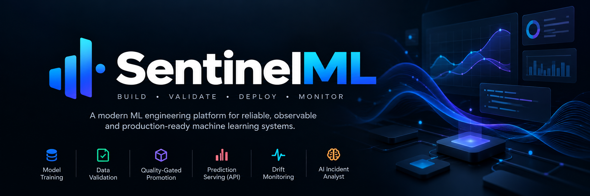

<div align="center">
  

  <br />

  <h1>SentinelML</h1>

  <p><strong>Build reliable machine learning systems. Monitor them with confidence.</strong></p>

  <p>
    An ML engineering platform for reproducible training, quality-gated model promotion,
    API-based inference, and feature drift monitoring.
  </p>

  <p>
    <a href="https://github.com/aayush-borse/sentinelml/actions">
      
    </a>
    
    
    
    
    
  </p>

  <p>
    <a href="#overview">Overview</a> ·
    <a href="#features">Features</a> ·
    <a href="#architecture">Architecture</a> ·
    <a href="#getting-started">Getting Started</a> ·
    <a href="#api-reference">API Reference</a> ·
    <a href="#roadmap">Roadmap</a>
  </p>
</div>

---

## Overview

Machine learning systems need more than a trained model. They need repeatable training workflows, measurable quality checks, reliable inference interfaces, and visibility into changes in incoming data.

**SentinelML brings these engineering concerns into one platform.**

It combines a Python-based ML pipeline with a FastAPI service and monitoring capabilities. Models can be trained through a CLI, evaluated against a configurable quality threshold, served through HTTP endpoints, and monitored for feature distribution changes.

An optional LLM-powered incident analyst can help interpret monitoring results and produce investigation guidance.

### The workflow

```text
         DATA
          │
          ▼
    Data Validation
          │
          ▼
   Model Training
          │
          ▼
    Model Evaluation
          │
          ▼
  Quality Gate (ROC-AUC)
          │
          ▼
   Model Promotion
          │
          ▼
   API-based Inference
          │
          ▼
   Drift Monitoring
          │
          ▼
   Incident Analysis
```

> **Current scope:** SentinelML is an engineering project and demonstration platform. Its default dataset is synthetic, so its results demonstrate the workflow rather than establish performance on a real-world problem.

## Features

| Capability               | Description                                                                                  |
| ------------------------ | -------------------------------------------------------------------------------------------- |
| Reproducible training    | Train a scikit-learn classification pipeline using configurable settings.                    |
| Data validation          | Validate input data before model training or inference.                                      |
| Quality-gated promotion  | Evaluate model quality and apply an ROC-AUC threshold before promotion.                      |
| Model artifacts          | Save trained model artifacts and associated metadata.                                        |
| Prediction API           | Serve predictions through FastAPI endpoints.                                                 |
| Feature drift monitoring | Use the Population Stability Index (PSI) to identify changes in feature distributions.       |
| Model observability      | Inspect model information, prediction metrics, and monitoring results through API endpoints. |
| AI incident analyst      | Optionally use an LLM to interpret monitoring findings and suggest investigation steps.      |
| CLI workflow             | Run validation, training, model inspection, and monitoring commands from the terminal.       |
| Container support        | Run the application using Docker and Docker Compose.                                         |
| Automated testing        | Use pytest and CI workflows to check application behavior.                                   |

## Architecture

SentinelML separates model development, model serving, and monitoring into distinct responsibilities.

```text
┌─────────────────────────────────────────────────────┐
│                    User / Developer                 │
└───────────────────────┬─────────────────────────────┘
                        │
              ┌─────────┴─────────┐
              │                   │
              ▼                   ▼
      ┌───────────────┐   ┌────────────────┐
      │   Python CLI  │   │  Web Dashboard │
      └───────┬───────┘   └───────┬────────┘
              │                   │ HTTP
              ▼                   ▼
      ┌───────────────┐   ┌────────────────┐
      │  ML Pipeline  │   │   FastAPI      │
      │               │   │   Service      │
      └───────┬───────┘   └───────┬────────┘
              │                   │
              ▼                   ▼
      ┌───────────────┐   ┌────────────────┐
      │ Model Artifacts│  │ Predictions &  │
      │ and Evaluation │  │ Monitoring     │
      └───────────────┘   └───────┬────────┘
                                  │
                                  ▼
                         ┌─────────────────┐
                         │ Drift Analysis  │
                         │ and Optional AI │
                         └─────────────────┘
```

### Technology stack

| Layer                | Technologies            | Responsibility                                                      |
| -------------------- | ----------------------- | ------------------------------------------------------------------- |
| Language             | Python                  | ML workflows, validation, CLI, and backend logic                    |
| Machine learning     | scikit-learn            | Preprocessing, classification, and evaluation                       |
| Data processing      | pandas, NumPy           | Tabular data handling and numerical operations                      |
| API                  | FastAPI, Pydantic       | HTTP endpoints and request validation                               |
| Monitoring           | PSI-based analysis      | Detect feature distribution changes                                 |
| AI-assisted analysis | OpenAI API, optional    | Interpret monitoring findings                                       |
| Testing              | pytest                  | Automated tests                                                     |
| Frontend             | React, TypeScript, Vite | Interactive monitoring console, if included in the current checkout |
| Deployment           | Docker, Docker Compose  | Containerized execution                                             |
| Automation           | GitHub Actions          | Continuous integration                                              |

## How It Works

### 1. Validate the data

Input data is checked before it enters the training or prediction workflow. Validation helps catch unsuitable inputs early.

### 2. Train the model

The training pipeline builds a classification model using scikit-learn. Reproducible configuration and a consistent pipeline help make experiments easier to repeat.

### 3. Evaluate model quality

The trained model is evaluated using classification metrics, including ROC-AUC.

### 4. Apply the quality gate

Model promotion depends on whether the configured quality threshold is satisfied. This demonstrates a basic safeguard against promoting a model that fails the required evaluation criterion.

### 5. Serve predictions

FastAPI exposes endpoints for model information and inference. Clients can submit supported input data and receive predictions.

### 6. Monitor feature drift

The monitoring workflow compares feature distributions against a reference distribution using PSI.

Drift indicates that the input data distribution may have changed. It does **not**, by itself, prove that model accuracy has decreased.

### 7. Investigate incidents

When enabled and configured with an API key, the optional AI incident analyst can help summarize findings and suggest investigation steps.

AI-generated recommendations are advisory and should be verified before operational action.

## Getting Started

### Prerequisites

Install the following:

* Python 3.10 or newer, compatible with the project dependencies
* Git
* pip
* Docker and Docker Compose, if you want to run the containerized version

### 1. Clone the repository

```bash
git clone https://github.com/aayush-borse/sentinelml.git
cd sentinelml
```

### 2. Create a virtual environment

**Windows PowerShell**

```powershell
py -3.10 -m venv .venv
.\.venv\Scripts\Activate.ps1
```

If Python 3.10 is not installed, use another supported Python version.

**Linux / macOS**

```bash
python3 -m venv .venv
source .venv/bin/activate
```

### 3. Install dependencies

Upgrade pip:

```bash
python -m pip install --upgrade pip
```

Install the project dependencies:

```bash
python -m pip install -r requirements.txt
```

If the repository's `pyproject.toml` defines the package and its build configuration correctly, install the package in editable mode as well:

```bash
python -m pip install -e .
```

> If editable installation fails, check the build-system configuration in `pyproject.toml` before proceeding.

### 4. Configure environment variables

If the repository includes `.env.example`, copy it to `.env` and populate the values you need.

Windows PowerShell:

```powershell
Copy-Item .env.example .env
```

Linux / macOS:

```bash
cp .env.example .env
```

The AI incident analyst requires a valid OpenAI API key if you want to use that feature. Keep secrets in your local environment; **never commit your `.env` file or API keys**.

If the application does not load `.env` automatically, configure the required environment variables in your shell according to the implementation.

### 5. Run the CLI

With the environment activated and dependencies installed:

```bash
python -m sentinelml.cli --help
```

Use the commands shown by the CLI help to validate data, train the model, inspect model information, and run monitoring.

For example, if these commands are exposed by your current CLI:

```bash
python -m sentinelml.cli validate
python -m sentinelml.cli train
python -m sentinelml.cli model-info
python -m sentinelml.cli monitor
```

### 6. Start the API

If the FastAPI application object is exposed as `app` in `sentinelml.api`, run:

```bash
uvicorn sentinelml.api:app --reload
```

Open the interactive API documentation at:

```text
http://127.0.0.1:8000/docs
```

If the module path differs in your checkout, use the actual application import path.

## API Reference

The following endpoints describe the intended API surface. Exact request schemas and response fields are defined by the implementation and can be inspected through `/docs`.

| Method | Endpoint         | Purpose                                        |
| ------ | ---------------- | ---------------------------------------------- |
| `GET`  | `/health`        | Check API health                               |
| `GET`  | `/model-info`    | Inspect the current model and its metadata     |
| `POST` | `/predict`       | Generate predictions for supported input data  |
| `GET`  | `/monitor/drift` | Retrieve feature drift monitoring results      |
| `GET`  | `/metrics`       | Retrieve available prediction or model metrics |

### Example: health check

```bash
curl http://127.0.0.1:8000/health
```

### Example: inspect the model

```bash
curl http://127.0.0.1:8000/model-info
```

### Example: prediction

The `/predict` endpoint expects the request body defined by the API's Pydantic schema. Open `/docs` to inspect the required fields and submit a valid request.

## Drift Monitoring

SentinelML uses the Population Stability Index (PSI) to compare a reference feature distribution with a monitored distribution.

PSI is a distribution-change indicator, not a direct measure of predictive performance.

Interpretation thresholds depend on the application and should be calibrated to the data and business context. A drift alert should trigger investigation rather than automatically be treated as proof that the model is failing.

Useful follow-up checks include:

* Validate the incoming data schema.
* Check for missing values and unexpected categories.
* Investigate upstream data or feature-generation changes.
* Compare current model performance with a labeled evaluation set when labels become available.
* Retrain only when the evidence supports it.

## Docker

If the repository contains a working `Dockerfile` and `docker-compose.yml`, you can use Docker Compose to build and start the configured services:

```bash
docker compose up --build
```

Stop the services with:

```bash
docker compose down
```

Review the Compose configuration for exposed ports, environment variables, volumes, and service names before running it.

## Testing

Run the test suite from the repository root:

```bash
pytest -q
```

If the project uses Ruff for linting and formatting, run the checks configured in `pyproject.toml`:

```bash
ruff check .
ruff format --check .
```

The exact checks depend on the project's installed development dependencies and configuration.

## Project Structure

The repository is organized around the Python package, tests, configuration, and deployment files.

```text
sentinelml/
├── .github/
│   └── workflows/
├── docs/
│   └── assets/
│       └── sentinelml-banner.png
├── src/
│   └── sentinelml/
│       ├── cli.py
│       ├── api.py
│       └── ...
├── tests/
├── .env.example
├── .gitignore
├── Dockerfile
├── docker-compose.yml
├── pyproject.toml
├── requirements.txt
└── README.md
```

The exact package modules and frontend directories may vary by branch. Refer to the current repository for the authoritative file structure.

## Engineering Principles

SentinelML is designed to demonstrate several important ML engineering practices:

* **Reproducibility:** Keep training workflows consistent and repeatable.
* **Validation before execution:** Catch invalid inputs before they propagate.
* **Explicit quality gates:** Make model promotion dependent on measurable evaluation criteria.
* **Separation of concerns:** Keep training, serving, and monitoring responsibilities distinct.
* **Observable behavior:** Expose useful model and monitoring information.
* **Testability:** Use automated tests to verify critical behavior.
* **Secure configuration:** Keep API keys and other secrets outside version control.
* **Evidence-driven operations:** Treat drift and AI-generated explanations as investigation signals, not unquestionable conclusions.

## Current Limitations

SentinelML is a learning and engineering project, not a certified production ML platform.

* The default classification dataset is synthetic.
* Demonstrated model quality does not establish real-world predictive performance.
* PSI identifies distribution changes but does not prove model degradation.
* The optional AI analyst depends on external API access and can produce inaccurate recommendations.
* Production use would require further work on authentication, authorization, deployment security, durable monitoring, alerting, model registry management, rollback, and operational validation.

These limitations are intentional to make the current scope clear and the next engineering priorities explicit.

## Roadmap

Potential future improvements include:

* [ ] Add support for real-world datasets and repeatable evaluation benchmarks.
* [ ] Introduce a more comprehensive model registry and artifact lifecycle.
* [ ] Implement model rollback and promotion history.
* [ ] Add persistent monitoring history and configurable alerting.
* [ ] Expand data validation and schema compatibility checks.
* [ ] Add model performance monitoring when labeled data becomes available.
* [ ] Strengthen API authentication and deployment security.
* [ ] Improve integration and end-to-end test coverage.
* [ ] Expand deployment support and operational documentation.

## Contributing

Contributions, bug reports, and suggestions are welcome.

1. Fork the repository.
2. Create a focused feature branch.
3. Make your changes and add tests where appropriate.
4. Run the available tests and quality checks.
5. Open a pull request describing the change and its motivation.

For substantial changes, open an issue first to discuss the proposed approach.

## License

This project is distributed under the license included in the repository. See [`LICENSE`](LICENSE) for the applicable terms.

---

<div align="center">
  <p><strong>SentinelML</strong></p>
  <p>Build. Validate. Deploy. Monitor.</p>
  <sub>Designed to make machine learning workflows more reliable, observable, and reproducible.</sub>
</div>
